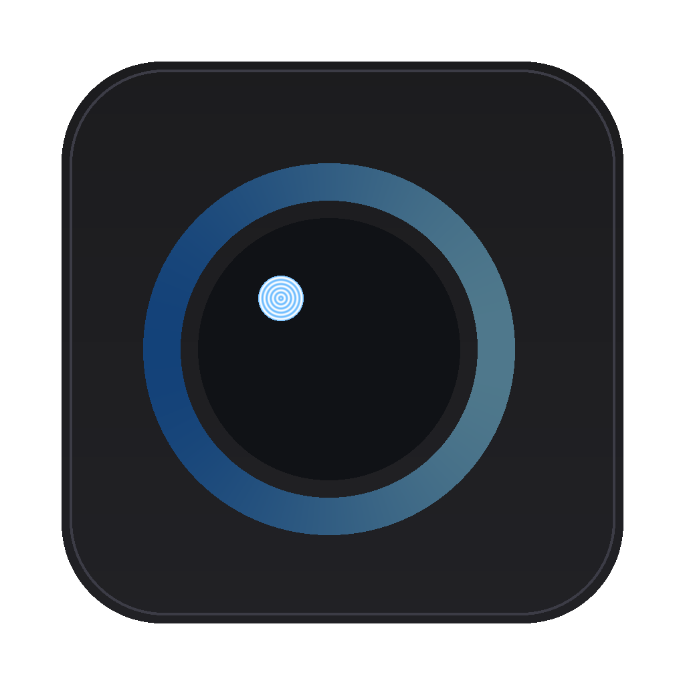

# CodeLens

   

**A code editor whose AI shows its reasoning in real time — token by token, alternative by alternative, before it ever shows you the code.**



CodeLens is a lightweight, VS Code–style desktop editor. When you ask its built-in AI to change your code, the model's *thinking* streams into a side panel as it happens: which lines of your file it reads as context, which alternatives it considered and discarded, and why it finally picked the code it proposes. Only then does the diff appear, which you accept or reject line by line — like a code review.

---

## Why it exists

Every mainstream AI editor (Copilot, Cursor, Windsurf) treats the model as a black box that hands over finished code. CodeLens does the opposite: it makes the model's decision process **visible, clickable, and auditable**. That is valuable pedagogically (you watch *why* a change was chosen) and professionally (you can trust or reject a suggestion with judgment, not blind faith).

## Features

- **Live reasoning panel** — watch the model's step-by-step thinking stream in as it is generated (not a fake animation).
- **Clickable line references** — every `<ref>` the model makes jumps the editor to that exact line.
- **"Road not taken" alternatives** — discarded approaches are rendered inline with a distinct visual marker.
- **Diff review** — proposed code shows up as a line-level diff with accept/reject per hunk and accept/reject all.
- **Monaco editor** — the same engine that powers VS Code: syntax highlighting, multi-cursor, minimap, find & replace.
- **Multi-provider, BYOK** — Anthropic (Claude), OpenAI (GPT), Google (Gemini) and any OpenAI-compatible endpoint (Ollama, LM Studio, OpenRouter, Groq…), each with its own key.
- **Secure key storage** — API keys live in your OS credential store (Windows Credential Manager / macOS Keychain / Linux Secret Service), never in config files, never sent anywhere except the provider you chose.
- **No servers, no billing** — CodeLens ships without APIs of its own; you bring your own keys and pay the providers directly.
- **Small and fast** — a Tauri (Rust + WebView) desktop shell: ~10–20 MB binaries, low RAM, fast startup.
## How the reasoning stream works

The system prompt forces the model to structure every response as two strict XML sections:

```xml
<reasoning>
  The model's visible thinking: context it used (<ref>12</ref> line references),
  alternatives it considered (<alt>…</alt>), and the final decision.
</reasoning>
<code>
  The complete replacement file — never a diff, never wrapped in backticks.
</code>
```

On the backend (Rust), a single provider-agnostic `AIProvider` trait exposes one method:
`stream_completion() -> Stream<TokenChunk>`. Each provider (Anthropic, OpenAI, Google, compatible) only translates its own API's wire format into that stream; everything downstream is shared.

An **incremental, provider-independent parser** consumes the raw token stream in real time. It keeps a small lookahead buffer so tags split across token boundaries (`<ref`, `</alt`, `<co…`) are handled correctly, and it emits typed events (`reasoning_text`, `alt_begin`, `alt_text`, `alt_end`, `ref`, `code_begin`, `code_text`, `code_end`) which are forwarded to the frontend through Tauri IPC events as they arrive. The frontend renders reasoning instantly and assembles the `<code>` payload into a line-level diff against your saved file. No token is ever buffered until the response ends — what the model emits is what you see, live.

## Installation

### Option 1 — One-click launchers (developers)

If you have [Node.js](https://nodejs.org) and [Rust](https://rustup.rs) installed, clone the repository and just double-click (or run) one file:

| OS | File | How to run |
| --- | --- | --- |
| Windows | `start.cmd` | double-click, or `start.cmd build` / `start.cmd test` |
| macOS | `start.sh` | `chmod +x start.sh && ./start.sh` |
| Linux | `start.sh` | `chmod +x start.sh && ./start.sh` |

The launcher installs npm dependencies on first run and starts CodeLens in development mode. Useful flags: `build` (produce installers) and `test` (run the Rust test-suite).

### Option 2 — Install a release binary (everyone)

Download the installer for your platform from the **Releases** page (top-right sidebar of this repository):

- **Windows** — `.msi` (MSI) and `-setup.exe` (NSIS)
- **macOS** — `.dmg`
- **Linux** — `.deb` and `.AppImage`

No account or API needed to install — you only configure your own AI key later (see [Bring your own key](#bring-your-own-key-byok)).

### Option 3 — Run from source

```bash
git clone https://github.com/novrekdevelop/codelens.git
cd codelens
npm install
npm run tauri dev
```

Prerequisites:

| OS | Required system packages |
| --- | --- |
| Windows 10/11 | [Node.js ≥ 18](https://nodejs.org), [Rust](https://rustup.rs), MSVC Build Tools, WebView2 (pre-installed on Windows 11) |
| macOS | [Node.js ≥ 18](https://nodejs.org), [Rust](https://rustup.rs), Xcode Command Line Tools (`xcode-select --install`) |
| Linux (Debian/Ubuntu) | `sudo apt install libwebkit2gtk-4.1-dev build-essential curl wget file libxdo-dev libssl-dev libayatana-appindicator3-dev librsvg2-dev libgtk-3-dev patchelf` plus Node.js ≥ 18 and Rust |

Full instructions: [Tauri v2 prerequisites](https://tauri.app/start/prerequisites/).

### Building installers yourself

`npm run tauri build` produces installers in `src-tauri/target/release/bundle/`. To build only some formats:

```bash
# Windows
npm run tauri build -- --bundles nsis,msi
# macOS
npm run tauri build -- --bundles dmg
# Linux (skip `.rpm` — only build `.deb` and `.AppImage`)
npm run tauri build -- --bundles deb,appimage
```
## Bring your own key (BYOK)

CodeLens does **not** ship with its own API key and does **not** run a billing or proxying backend. Your requests go **directly** from your machine to the provider you configure, authenticated by your own key. You pay the provider for your own usage, nothing more.

1. Open Settings → **AI Providers**.
2. Pick a provider and paste your key; adapt the base URL/model if needed (see below for compatible endpoints).
3. Click **Test connection** to validate the key before saving.
4. Mark one provider as **active**.
5. Open a file, type a request (e.g. *"refactor this function to make it more readable"*) and hit **Ask AI**.

Provider defaults:

| Provider | Base URL | Model |
| --- | --- | --- |
| Anthropic | `https://api.anthropic.com` | `claude-sonnet-4-5` |
| OpenAI | `https://api.openai.com/v1` | `gpt-4o` |
| Google | `https://generativelanguage.googleapis.com` | `gemini-2.0-flash` |
| OpenAI-compatible endpoint | *your* endpoint (e.g. `http://localhost:11434/v1` for Ollama) | *your* model |

> For OpenAI-compatible endpoints the key is optional — local servers like Ollama and LM Studio usually accept requests without one, while OpenRouter/Groq/VLLM gateways use your key as a Bearer token.

> On Linux, saved keys are stored in the desktop **Secret Service** (GNOME Keyring / KWallet). In a headless session without a keyring service, key persistence is unavailable and you will be asked to re-enter the key.

## Roadmap

- [x] Monaco editor, file tree, multi-tab, save/open
- [x] Provider settings with secure BYOK key storage and "Test connection"
- [x] Live reasoning stream with `<ref>` line links and `<alt>` alternatives
- [x] Line-level diff review, conflict-free apply, "ask for an alternative"
- [ ] Multi-file context (symbol-level indexing) and cross-file code references
- [ ] Editable reasoning (leave inline comments on the model's thinking)
- [ ] Conversation memory across requests
- [ ] Reasoning replay / saved reasoning transcripts
- [ ] Theme customization and command palette
- [ ] Local model presets with auto-configured base URLs (Ollama, LM Studio)

## Contributing

Contributions are welcome! See [CONTRIBUTING.md](CONTRIBUTING.md) for the development setup, project layout and the pull-request checklist. Please read our [Code of Conduct](CODE_OF_CONDUCT.md); security issues can be reported privately through the **Security** tab — see [SECURITY.md](SECURITY.md).

## License

[MIT](LICENSE) © CodeLens contributors.